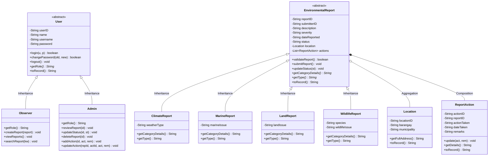

# EcoWatch: System Architecture, Enhancements & Changelog

**Project Name:** EcoWatch – Environmental Monitoring and Reporting System  
**Course:** PF 101 – Object-Oriented Programming (Performance Task)  
**Group:** Group 6 | **Section:** PF101 - A  
**Anchor SDGs:** SDG 13 (*Climate Action*), SDG 14 (*Life Below Water*), SDG 15 (*Life on Land*)

---

## 📖 1. Executive Summary

EcoWatch is a desktop Java application engineered to centralize environmental reporting, community monitoring, and administrative follow-up tracking. Built with strict adherence to Object-Oriented Programming principles and backed by a makeshift database powered by Java NIO File I/O, the system bridges the gap between community observers who encounter environmental incidents and authorized personnel who review, coordinate, and resolve them.

This document details all **features added**, **proposal gaps closed**, **architectural patterns applied**, and **production-level UI/UX enhancements** implemented across the codebase.

---

## 🏛️ 2. Object-Oriented Programming (OOP) Pillars

EcoWatch demonstrates the four foundational pillars of OOP and core object relationships across its architecture:



### Demonstration of Principles

| Principle | Where & How Applied in EcoWatch |
| :--- | :--- |
| **Encapsulation** | All entity fields are `private`. State transitions (e.g., status changes, credentials, and actions) are strictly mediated through validated methods (`login()`, `changePassword()`, `updateStatus()`, `validateReport()`). |
| **Inheritance** | • `Observer` and `Admin` inherit account attributes, session routines, and validation from `User`.<br>• `ClimateReport`, `MarineReport`, `LandReport`, and `WildlifeReport` inherit core metadata, validation, and lifecycle routines from `EnvironmentalReport`. |
| **Polymorphism** | Dynamic method dispatch is utilized extensively:<br>• `getCategoryDetails()` and `getType()` dynamically resolve category-specific attributes at runtime.<br>• `getRole()` enables role-specific behavior while treating users as uniform `User` references. |
| **Abstraction** | Superclasses `User` and `EnvironmentalReport` are declared `abstract` to prevent direct instantiation of incomplete models. `FileManager` abstracts low-level file I/O operations away from UI and domain classes. |
| **Aggregation** | An `EnvironmentalReport` references a `Location`. Locations can exist independently of reports. |
| **Composition** | An `EnvironmentalReport` owns a list of `ReportAction` objects. Actions are tied to a specific report; deleting a report cascades and removes all child actions. |

---

## 🚀 3. Summary of Changes, Additions & Enhancements

### 3.1 Proposal Specifications & Functional Gaps Resolved

1. **User Password Management (Proposal Feature #1)**:
   * **Domain Logic**: Added `changePassword(currentPassword, newPassword)` in `User.java` with credential verification and blank-string rejection.
   * **Persistence**: Added `updateUser(User u)` in `FileManager.java` to safely overwrite credentials in `data/users.txt`.
   * **User Interface**: Created `ChangePasswordDialog.java` and integrated "Change Password" buttons into both `ObserverFrame.java` and `AdminFrame.java`.

2. **Observer Transparency & Action History (Proposal Features #3 & #5)**:
   * **Unified Dialog**: Built `ReportDetailsDialog.java` allowing Observers to view complete details, geolocation, and the chronological follow-up action log for any report.
   * **Shortcuts**: Added "View Details & Actions" button and table double-click support to `ObserverFrame.java`.

3. **Follow-Up Action Maintenance (Proposal Feature #5)**:
   * **Entity Mutator**: Added `update(actionTaken, remarks)` in `ReportAction.java`.
   * **Data Layer**: Added `updateAction(ReportAction a)` in `FileManager.java`.
   * **Admin Capability**: Added `updateAction(...)` in `Admin.java`, enabling administrators to select and modify logged actions directly inside `ReportDetailsDialog.java`.

4. **Input Validation & Safety**:
   * Added password confirmation and minimum length checks during observer registration in `LoginFrame.java`.
   * Added explicit submission feedback dialogs in `SubmitReportDialog.java`.

---

### 3.2 Production-Ready UI/UX Overhaul

1. **Centralized Design System (`UITheme.java`)**:
   * Curated palette: Deep Forest Green (`#166534`), Slate Background (`#F8FAFC`), Slate Borders (`#E2E8F0`).
   * Semantic badge colors for Severity (`LOW`, `MEDIUM`, `HIGH`) and Status (`PENDING`, `UNDER REVIEW`, `RESOLVED`).
   * Custom rounded buttons with dynamic hover, focus, and pressed states (`createPrimaryButton`, `createSecondaryButton`, `createDangerButton`).

2. **Typography & Platform Integration (`Main.java`)**:
   * Activated subpixel LCD font antialiasing (`awt.useSystemAAFontSettings=lcd`, `swing.aatext=true`) for crisp typography on Windows displays.
   * Set native system Look & Feel (`UIManager.getSystemLookAndFeelClassName()`).

3. **Custom Application Icon (`UITheme.java`)**:
   * Programmatically generated 64x64 vector-grade environmental seedling emblem set across window titlebars and the Windows taskbar via `UITheme.setupWindow()`.

4. **Table Badge Renderers (`UITheme.java`)**:
   * Custom `BadgeCellRenderer` renders Severity and Status as colored pill badges with border outlines.
   * Alternating zebra row striping and soft mint selection highlighting.
   * Standardized row heights (32px) and centered data alignments.

5. **Accessibility & Ergonomics**:
   * `Escape` key automatically dismisses modal dialogs.
   * `Enter` key triggers primary actions (login, filter, submission).
   * Enforced minimum window bounds to prevent component crowding during resize.

---

### 3.3 Advanced Dashboard & Data Tools (`ReportTablePanel.java`)

1. **Real-time Live Keyword Filter**:
   * Instant search responding to keystrokes via `DocumentListener`.
2. **Multi-Dropdown Filtering**:
   * Filter simultaneously by **Category** (`CLIMATE`, `MARINE`, `LAND`, `WILDLIFE`), **Status** (`PENDING`, `UNDER REVIEW`, `RESOLVED`), and **Severity** (`LOW`, `MEDIUM`, `HIGH`).
3. **Interactive Clickable KPI Cards**:
   * Real-time metric pills (`Total`, `Pending`, `Under Review`, `Resolved`) double as one-click quick filters.
4. **Column Sorting**:
   * Header-click sorting enabled via `TableRowSorter`.
5. **CSV Data Export Tool**:
   * `📥 Export CSV` button with `JFileChooser` exports currently filtered table views to standard `.csv` spreadsheet files with timestamped headers.

---

### 3.4 Realistic Demonstration Data Seeding (`FileManager.java`)

`FileManager.seedSampleDataIfEmpty()` automatically populates 4 realistic Philippine environmental incident scenarios covering all report types and SDGs:

| Report ID | Category | Subclass | Severity | Status | Incident Location | Description Summary |
| :--- | :--- | :--- | :--- | :--- | :--- | :--- |
| **`R001`** | Climate (SDG 13) | `ClimateReport` | `HIGH` | `UNDER REVIEW` | Tuguegarao East, Tuguegarao City | Flash flood threats following persistent heavy rainfall. Emergency boat rescue actions logged. |
| **`R002`** | Marine (SDG 14) | `MarineReport` | `MEDIUM` | `RESOLVED` | Sabang, Puerto Galera | Plastic accumulation on nearshore reefs. 45-volunteer coastal cleanup action logged. |
| **`R003`** | Land (SDG 15) | `LandReport` | `HIGH` | `PENDING` | San Mateo, Norzagaray | Illegal quarrying and timber clearing causing hillside slope instability. |
| **`R004`** | Wildlife (SDG 15) | `WildlifeReport` | `LOW` | `RESOLVED` | Malagos, Davao City | Grounded juvenile Philippine eagle rescue and rehabilitation action logged. |

---

## 📂 4. Complete Codebase Inventory

| File | Type | Primary Responsibility & Role in Architecture |
| :--- | :--- | :--- |
| `Main.java` | Class | Application entry point; initializes font antialiasing, Look & Feel, default admin user, demo data seeding, and opens `LoginFrame`. |
| `UITheme.java` | Utility | Centralized design system; brand colors, typography, vector icon generator, styled button factories, and badge table renderers. |
| `User.java` | Abstract Class | Superclass for system users; encapsulates credentials, authentication, password changing, and defines abstract `getRole()`. |
| `Observer.java` | Concrete Class | Inherits from `User`; represents community observers who submit and track reports. |
| `Admin.java` | Concrete Class | Inherits from `User`; represents authorized personnel who review, update statuses, cascade-delete, and log/edit follow-up actions. |
| `EnvironmentalReport.java` | Abstract Class | Base model for reports; encapsulates metadata, location aggregation, action composition, validation, and serialization. |
| `ClimateReport.java` | Concrete Class | Subclass of `EnvironmentalReport` handling weather anomalies (Floods, Typhoons, Droughts). |
| `MarineReport.java` | Concrete Class | Subclass of `EnvironmentalReport` handling ocean/coastal issues (Oil spills, Coral damage, Marine debris). |
| `LandReport.java` | Concrete Class | Subclass of `EnvironmentalReport` handling terrestrial threats (Deforestation, Illegal logging, Soil erosion). |
| `WildlifeReport.java` | Concrete Class | Subclass of `EnvironmentalReport` handling endangered/injured fauna and biodiversity incidents. |
| `Location.java` | Concrete Class | Encapsulates barangay and municipality geolocation data; aggregated by reports. |
| `ReportAction.java` | Concrete Class | Encapsulates administrative follow-up interventions; composed into parent reports. |
| `FileManager.java` | Utility / DAO | Handles CRUD operations for flat `.txt` files, delimited record parsing, ID generation, and sample data seeding. |
| `LoginFrame.java` | GUI Frame | Authenticates users and registers new Observer accounts with validation and card layout. |
| `ObserverFrame.java` | GUI Frame | Observer dashboard; top navigation bar, report browsing, details dialog launcher, and password management. |
| `AdminFrame.java` | GUI Frame | Administrator dashboard; report management, status updates, action logging, cascade deletion, and password management. |
| `ReportTablePanel.java` | GUI Component | Reusable panel featuring live search, multi-dropdown filtering, clickable KPI cards, badge rendering, and CSV export. |
| `ReportDetailsDialog.java` | GUI Modal | Unified modal showing report metadata, location, description, and action history table with Admin action tools. |
| `SubmitReportDialog.java` | GUI Modal | Dynamic form toggling category-specific input fields based on selected environmental category. |
| `ChangePasswordDialog.java` | GUI Modal | Validated password change dialog ensuring old password verification, confirmation match, and minimum length. |

---

## 🗄️ 5. Makeshift Database Specifications (`data/`)

All records are stored as pipe-delimited text (`|`) managed by `FileManager.java`:

* **`users.txt`**:
  ```text
  userID|role|name|username|password
  ```
* **`reports.txt`**:
  ```text
  reportID|type|submitterID|description|severity|dateReported|status|locationID|extraData...
  ```
  *(Note: `extraData` contains category-specific fields serialized polymorphically by each report subclass).*
* **`locations.txt`**:
  ```text
  locationID|barangay|municipality
  ```
* **`actions.txt`**:
  ```text
  actionID|reportID|actionTaken|dateTaken|remarks
  ```

---

## ✅ 6. Verification & Testing

* **Compilation**: Clean compilation with `javac` with **0 errors and 0 warnings**.
* **Integrity**: Deletion cascading verified (deleting a report safely deletes the corresponding location and all associated actions).
* **Cross-Role Validation**: Tested authentication, password changes, report submission, and administrative action logging.
